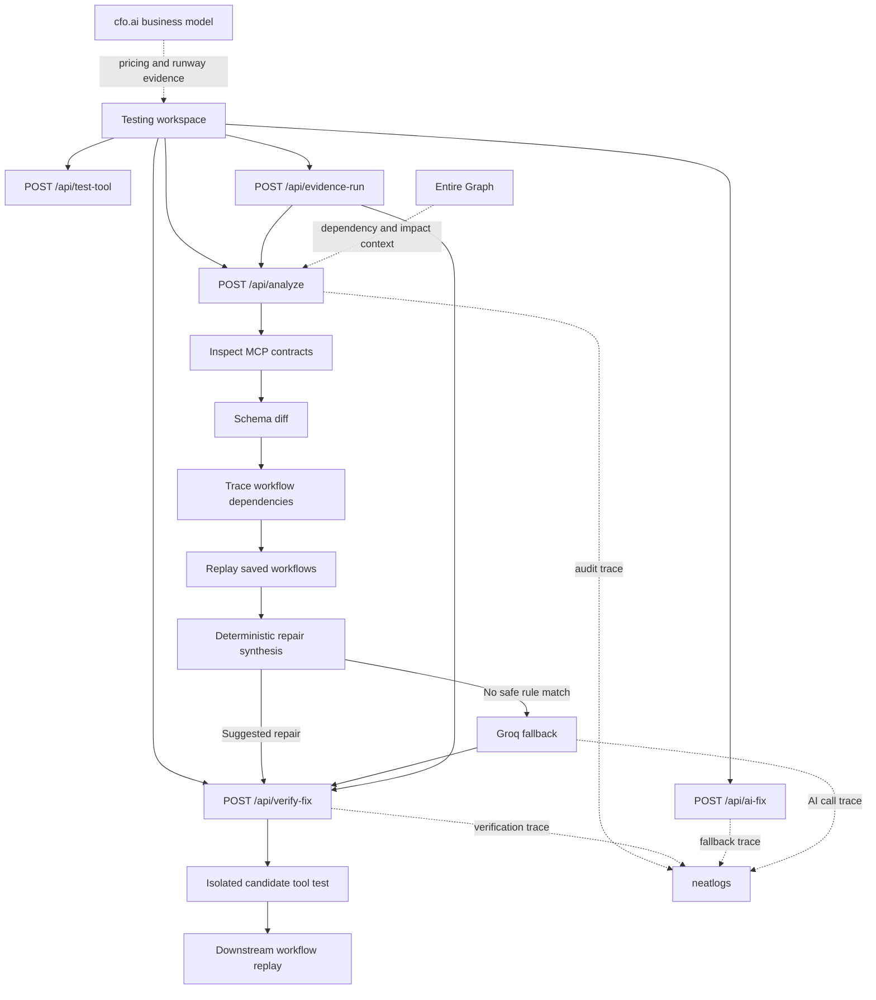

# MCPGuard

MCPGuard prevents agent workflows from breaking when an MCP server changes. It compares tool contracts, replays saved multi-step workflows, identifies the failure boundary, proposes a migration, and verifies the recovery before release.

## Why it exists

MCP tools are contracts. A parameter rename, a tightened type, or a new required field can break the first tool call in an agent workflow and starve every later step of context. MCPGuard gives that change a repeatable release check:

1. Inspect baseline and candidate MCP servers.
2. Diff tool input schemas and classify breaking changes.
3. Trace saved workflows that depend on changed tools.
4. Replay each workflow against both versions.
5. Generate a deterministic migration where possible.
6. Escalate ambiguous migrations to Groq only when no deterministic rule matches.
7. Verify the repaired call in isolation and replay the downstream workflow.

## Product surfaces

| Surface | Purpose |
|---|---|
| `/` | Product overview, workflow explanation, and integration status. |
| `/test` | Interactive workspace for payload tests, release audits, repair verification, Groq fallback, and recovery evidence. |
| `POST /api/analyze` | Runs contract inspection, diffing, dependency tracing, workflow replay, and fix synthesis. |
| `POST /api/test-tool` | Runs one editable payload against the candidate MCP contract. |
| `POST /api/verify-fix` | Performs isolated-call and full-workflow repair verification. |
| `POST /api/ai-fix` | Exercises the explicitly labeled non-deterministic Groq fallback path. |
| `POST /api/evidence-run` | Produces one failure-to-recovery evidence run for the demo. |

## Architecture



```text
Testing workspace
  -> /api/analyze
      -> inspect baseline and candidate MCP contracts
      -> schema diff + workflow dependency trace
      -> chained workflow replay
      -> deterministic repair or Groq fallback
  -> /api/verify-fix
      -> isolated candidate tool test
      -> downstream workflow replay
```

The current demo server pair is intentionally in-process so compatibility checks are fast and isolated. The engine uses the official MCP SDK's in-memory transport; it does not open local ports or send tool calls to production systems.

## Integrations

### neatlogs

Live audit and recovery routes are wrapped in neatlogs spans. The project emits:

- `mcp-compatibility-analysis` for audits
- `mcp-verify-fix` for two-stage repair verification
- `mcp-ai-fallback` for the AI-assisted fallback scenario
- `groq-schema-migration` for the Groq model call
- `mcp-recovery-evidence` for the end-to-end failure-and-recovery demonstration

Trace metadata is intentionally limited for the Groq fallback: it records the tool name, argument keys, and schema-change count rather than full argument values.

### Entire

Entire Graph is used to understand the blast radius of the audit coordinator and repair synthesizer before changing them. The checked-in evidence, commands, and current impact results are in [ENTIRE_CONTEXT.md](ENTIRE_CONTEXT.md).

### cfo.ai

The business model covers pricing, cost of goods, revenue, gross margin, runway, and break-even assumptions. See [BUSINESS_PLAN.md](BUSINESS_PLAN.md). A shareable cfo.ai scenario or exported PDF can accompany the model as supporting evidence.

## Quick start

### Requirements

- Node.js 20 or newer
- `GROQ_API_KEY` for AI-assisted fallback tests
- `NEATLOGS_API_KEY` for exported telemetry traces

### Install and run

```bash
npm install
npm run dev
```

Open `http://localhost:3000` for the product page or `http://localhost:3000/test` for the testing workspace.

### Environment

Create `.env` from `.env.example`:

```ini
GROQ_API_KEY=your_groq_key
NEATLOGS_API_KEY=your_neatlogs_key
```

Do not commit real keys.

### Verify

```bash
npm run build
npm test
```

## Demo flow

1. Open `/test` and run an isolated payload test.
2. Run the release audit to inspect contract changes and replay results.
3. Verify a suggested deterministic migration.
4. Run the AI-assisted fallback to show the Groq path for an ambiguous migration.
5. Generate recovery evidence to show failure, repair, and full workflow verification in one run.

## Documentation

- [Hackathon evidence guide](HACKATHON_EVIDENCE.md)
- [Entire Graph topology and impact evidence](ENTIRE_CONTEXT.md)
- [Business plan and cfo.ai inputs](BUSINESS_PLAN.md)
- [Project overview](PROJECT_OVERVIEW.md)
- [Collaborator guide and API reference](COLLABORATOR_GUIDE.md)

## Current limitations

- The included MCP servers are controlled in-process fixtures used to demonstrate compatibility behavior. Production adapters for external stdio or remote MCP servers are a next step.
- Entire checkpoints and a shareable cfo.ai scenario are external artifacts and must be captured from their respective services before a submission.
